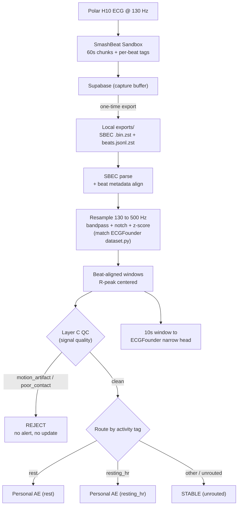
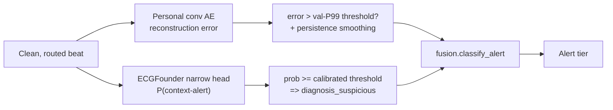
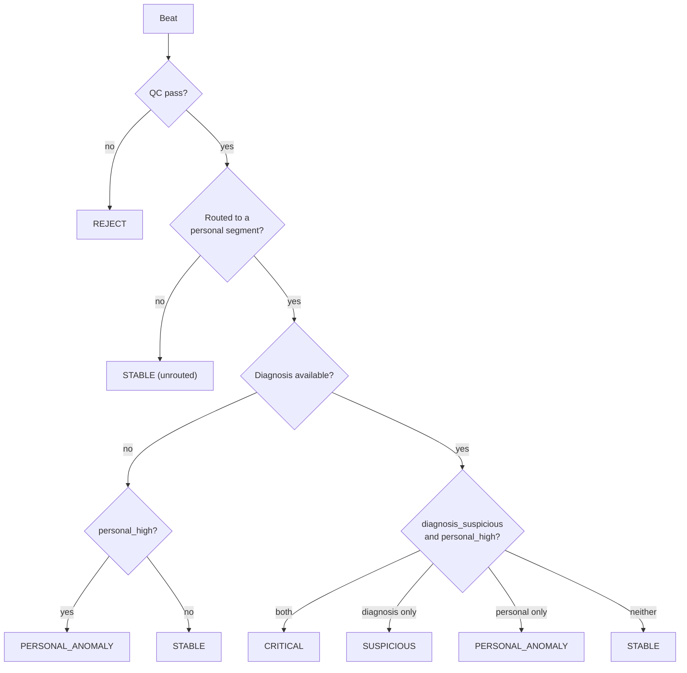

# HAWLEY ML

Personalized, multi-model ECG analysis for **longitudinal Polar H10 data** captured via the SmashBeat Sandbox. The system learns an individual's normal cardiac morphology, flags deviations from *their own* baseline, and layers a population diagnosis model on top — with explicit signal-quality vetoes so motion artifacts never trigger alerts.

Single subject today (**Micah**); designed to scale to more subjects later.

> **Runs fully local / offline.** The project used AWS for a one-time model training run; that account is now closed and all outputs are on disk. There is **no cloud dependency** — see [`docs/AWS_OFFBOARD.md`](docs/AWS_OFFBOARD.md).

---

## Status

| Area | State |
|------|-------|
| Phase 0 — feasibility | Complete |
| Phase 1 — personal baseline | **PASS** (1.75% false alert on rest) |
| Multi-model fusion + QC veto | Implemented |
| ECGFounder narrow diagnosis head | Trained (local + one SageMaker run); **weak proxy labels only** |
| Full-corpus batch scoring | Runs locally (diagnosis-integrated re-run pending) |
| Portable offline bundle | Buildable (`training.build_offboard_bundle`) |

| Resource | Location |
|----------|----------|
| Decision record | [`docs/PHASE1_DECISION.md`](docs/PHASE1_DECISION.md) |
| Architecture / handoff | [`docs/AGENT_CONTEXT.md`](docs/AGENT_CONTEXT.md) |
| Roadmap | [`docs/MULTIMODEL_ROADMAP.md`](docs/MULTIMODEL_ROADMAP.md) |
| Offline operation | [`docs/AWS_OFFBOARD.md`](docs/AWS_OFFBOARD.md) |
| Raw export | [`exports/2026-07-16T162705Z/`](exports/2026-07-16T162705Z/) |
| Batch config | [`configs/batch_micah_full.yaml`](configs/batch_micah_full.yaml) |
| Portable bundle | [`offboard/portable_bundle/`](offboard/portable_bundle/) |

---

## Data pipeline

Raw Polar H10 ECG is chunked and tagged on-device, exported once to a local archive, then bridged into ECGFounder's expected format and quality-gated before any model sees it.



**Tag layers** (all treated as *weak labels*, not ground truth):

| Layer | Purpose | Example tags |
|-------|---------|--------------|
| A | Kinematic context | `sedentary_stationary`, `walking`, `phone_motion` |
| B | Physiological context | `resting_hr`, `low_hrv`, `cognitive_stress` |
| C | Signal quality (**veto power**) | `clean_signal`, `motion_artifact`, `poor_contact` |

---

## Multi-model fusion

Two independent signals are combined per beat: the **personal autoencoder** (how far this beat deviates from the subject's own normal) and the **ECGFounder narrow head** (a population "context-alert" probability). Signal-quality QC can veto everything.



### Alert tiers

The tier logic lives in [`fusion/gating.py`](fusion/gating.py). `personal_high` = sustained personal alert **or** instantaneous error above threshold.



| Tier | Meaning |
|------|---------|
| `stable` | Normal for this subject; diagnosis (if present) normal |
| `personal_anomaly` | Deviates from personal baseline, diagnosis still normal |
| `suspicious` | Diagnosis fires on clean signal, personal error low — re-sample prompt |
| `critical` | Both agree abnormal on clean signal |
| `reject` | QC failed — no alert, no model update |

Each scored beat in the batch JSONL carries: `qc_pass`, `qc_veto_reason`, `activity_segment`, `reconstruction_error`, `smoothed_error`, `instant_above`, `sustained_above`, `alert_tier`, `diagnosis_suspicious`, `diagnosis_probability`, `model_slot`.

---

## Models

Personal autoencoder: 1-D convolutional AE, **1s beat-aligned window (500 samples @ 500 Hz)**, latent dim 32. Threshold = validation-set P99 of reconstruction error. Persistence layer requires a 5-beat moving average with 3 consecutive beats above threshold for a *sustained* alert.

| Model | Role | Key metric (held-out) | Artifact |
|-------|------|------------------------|----------|
| Personal AE — **rest** | personal baseline | **1.75%** false alert @ P99; 0% sustained | `artifacts/micah/phase1_beat/` |
| Personal AE — **resting_hr** | personal baseline | **0.70%** false alert @ P99; 0% sustained | `artifacts/micah/phase1_beat_resting_hr/` |
| ECGFounder narrow — **local** | `diagnosis_suspicious` | ~9.5% false-suspicious @ 0.725 *(proxy)* | `artifacts/micah/diagnosis_narrow/` |
| ECGFounder narrow — **SageMaker** | `diagnosis_suspicious` | ~7.0% false-suspicious @ 0.75 *(proxy)* | `artifacts/micah/diagnosis_narrow_sagemaker/` |

> **Diagnosis caveat:** the narrow head is a 2-class probe trained on **weak Sandbox-tag proxies** (`resting_hr` vs `elevated_hr`/`cognitive_stress`/…), **not clinical pathology**. ECGFounder zero-shot (150-class) flagged 99.5% of Polar beats suspicious and is **not** used as a gate. Replacing proxy labels with validated labels is the top roadmap item.

Base ECGFounder weights: `checkpoint/1_lead_ECGFounder.pth` (single-lead variant).

---

## Dataset coverage

Motion dominates this corpus, and QC (correctly) vetoes most of it. See [`reports/coverage/dataset_coverage.md`](reports/coverage/dataset_coverage.md).

| Metric | Count |
|--------|-------|
| Total beats | ~1,420,606 |
| Signal-clean (Layer C) | 342,914 |
| Routable to a personal AE | 336,971 |
| Recordings with routable beats | **5** (of 24 with chunks) |

The other ~19 long recordings tag `sedentary_stationary` but carry `motion_artifact` on nearly every beat, so Layer C QC vetoes them. This is expected behavior, not a loader bug.

---

## Repository layout

```
HAWLEY-ML/
├── datasets/        # SBEC binary parser, export archive reader, manifest
├── preprocessing/   # resample, ECGFounder prep, QC, beat/diagnosis windows, tag schema
├── models/          # personal_autoencoder, ecgfounder_wrapper, diagnosis_narrow
├── adaptation/      # artifact I/O, persistence/smoothing, training loop
├── fusion/          # gating.py (alert tiers) + pipeline.py (orchestration)
├── training/        # ecgfounder_narrow/ (prepare_data, train), build_offboard_bundle, prepare_offboard
├── evaluation/      # phase0_feasibility, personal_baseline_phase1, train_segments, calibrate_diagnosis, dataset_coverage
├── inference/       # batch_pipeline.py
├── vendor/ECGFounder/  # upstream model code (net1d, finetune_model)
├── configs/         # phase1 + batch + diagnosis YAML
├── artifacts/micah/ # trained bundles (.pt + bundle.json)  [large weights gitignored]
├── exports/         # raw Sandbox ECG  [⚠ tracked despite policy — see docs/NOT_IN_GIT.md]
├── reports/         # phase1, batch, coverage, calibration outputs
├── offboard/        # portable_bundle/ (self-contained offline) + OFFBOARD_STATUS.json
└── docs/            # AGENT_CONTEXT, MULTIMODEL_ROADMAP, PHASE1_DECISION, AWS_OFFBOARD
```

---

## ⚠️ Files not in Git (read before cloning / running)

Large weights and secrets are **intentionally untracked**, so **a fresh clone is not
runnable as-is** — `checkpoint/` and most of `artifacts/` are empty after cloning.

| Missing after clone | Size | Restore with |
|---|---|---|
| `checkpoint/1_lead_ECGFounder.pth` | ~353 MiB | download from [Hugging Face](https://huggingface.co/PKUDigitalHealth/ECGFounder) |
| `artifacts/micah/**/*.pt` (personal AE + diagnosis heads) | 0.6–117 MiB | `python -m evaluation.train_segments`, `python -m training.ecgfounder_narrow.train`, `python -m evaluation.calibrate_diagnosis` |
| `offboard/portable_bundle/artifacts/diagnosis_narrow/*.pt` | ~117 MiB | `python -m training.build_offboard_bundle` |
| `processed/**/*.npz` | — | `python -m training.ecgfounder_narrow.prepare_data` |
| `.env` | — | `copy .env.example .env` |

Full inventory, per-item rationale, and the step-by-step bootstrap:
[`docs/NOT_IN_GIT.md`](docs/NOT_IN_GIT.md).

> Known discrepancy: `exports/` (raw Sandbox ECG, ~18,130 files / ~144 MB) is
> annotated as gitignored but is currently **tracked**. See
> [`docs/NOT_IN_GIT.md`](docs/NOT_IN_GIT.md#discrepancy-exports-is-tracked-despite-the-policy).

---

## Quick start

```bash
python -m venv .venv
.venv\Scripts\activate            # Windows;  source .venv/bin/activate on *nix
pip install -r requirements.txt
```

Train and score:

```bash
# Personal baselines (rest + resting_hr segments)
python -m evaluation.train_segments

# Diagnosis narrow head (local) + threshold calibration
python -m training.ecgfounder_narrow.prepare_data
python -m training.ecgfounder_narrow.train
python -m evaluation.calibrate_diagnosis

# Full multi-model batch score
python -m inference.batch_pipeline --config configs/batch_micah_full.yaml

# Corpus coverage report
python -m evaluation.dataset_coverage
```

Build the self-contained offline bundle (models + code, no cloud):

```bash
python -m training.build_offboard_bundle
# then, to run inference entirely from the bundle:
cd offboard/portable_bundle && pip install -r requirements.txt
set PYTHONPATH=code
python -m inference.batch_pipeline --config configs/batch_micah_full.yaml
```

---

## Roadmap (all local)

1. **Better diagnosis labels** — replace weak Sandbox-tag proxies with clinician- or device-validated labels, then retrain the narrow head.
2. **Finish the diagnosis-integrated full batch** (last run was interrupted).
3. **Phase 4** — fusion tuning + LLM narrator over the structured batch JSON (wellness framing).
4. **Phase 5** — on-device inference (ONNX/LiteRT) in a dedicated capture app.

---

## Framing & constraints

- **Wellness / research positioning — not a medical device.** Sandbox tags are not clinical ground truth; any pathology language needs persistence + clean signal + human review.
- Do **not** commit raw ECG, `.env`, or secrets.
- Do **not** feed raw waveforms to an LLM (it narrates structured JSON only).
- SmashBeat (the Flutter capture app) stays as-is; this repo is ML-only.
